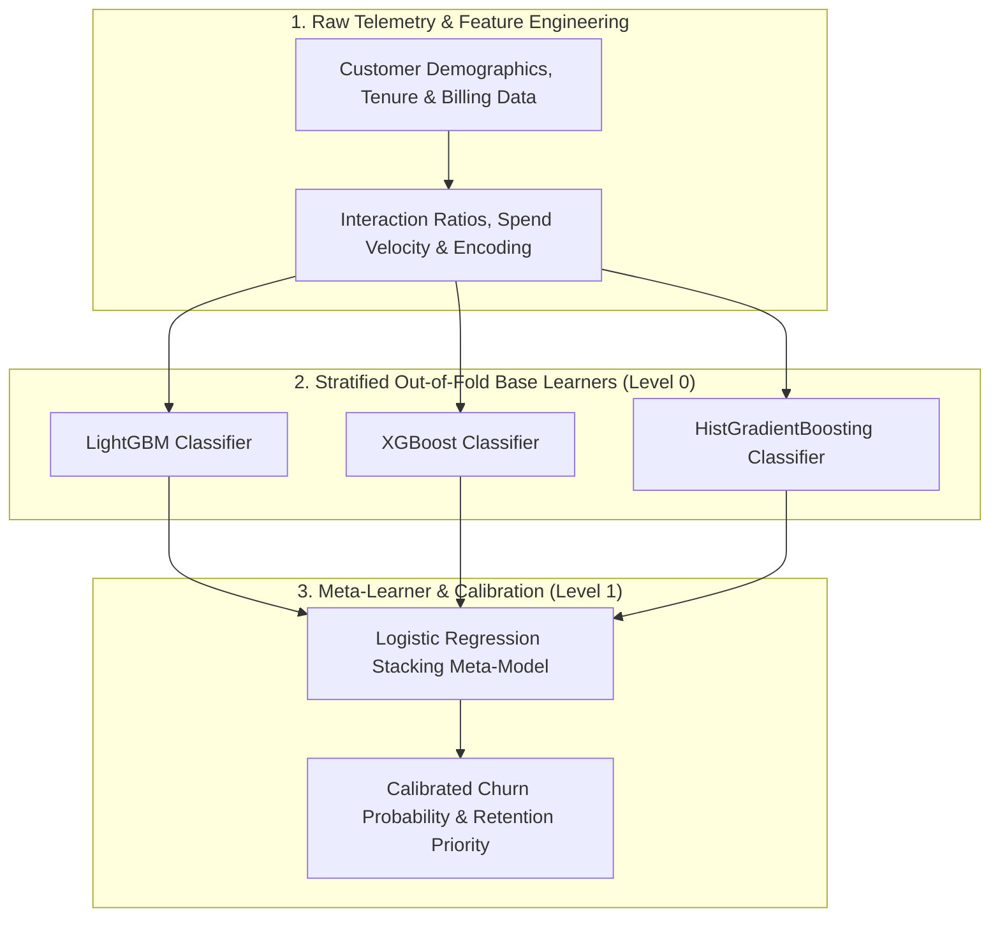

# Predict Customer Churn

> **Author & Architect:** [Robina Mirbahar](https://github.com/RobinaMirbahar) ([Google Developer Expert in Cloud & AI](https://developers.google.com/profile/u/106918534005910641104?utm_campaign=deveco_gdemembers&utm_source=deveco) · Google Cloud Champion Innovator · Co-Author of [*AI Engineering*](https://www.amazon.com/dp/B0GWCZWCF4))  
> **Focus:** End-to-End Feature Engineering, Out-of-Fold Stacking (HistGradientBoosting, LightGBM, XGBoost, Logistic Regression) & Probability Calibration

---

## 🎯 Why I Built Customer Churn Prediction — Stacked Ensemble Pipeline (Engineering Purpose & Real-World Value)

### 1. 📈 Beating Single-Model Baselines with Out-of-Fold Stacking
Single gradient-boosted trees often overfit noisy customer telemetry. I engineered a multi-model stacked ensemble combining `HistGradientBoosting`, `LightGBM`, `XGBoost`, and a calibrated `LogisticRegression` meta-learner.

### 2. 🛠️ Domain-Driven Behavioral Feature Engineering
I designed interaction ratios, tenure velocity features, and service-adoption density signals that capture early churn precursors before cancellation occurs.

### 3. 🎯 Leak-Free Stratified Cross-Validation
Every transformation and out-of-fold prediction is strictly isolated inside stratified K-fold splits to guarantee production-grade generalization.

---

## 🏗️ System Architecture



---

## Kaggle Playground Series – Season 6, Episode 3

[](https://www.kaggle.com/competitions/playground-series-s6e3)
[](https://www.python.org/)
[](https://opensource.org/licenses/MIT)

## 📝 Overview

This repository contains my solution for the **Kaggle Playground Series Season 6 Episode 3** competition. The goal is to predict the likelihood of customer churn based on a synthetically generated dataset that mimics real-world telecommunications customer behavior.

**Key details:**
- **Goal:** Predict probability of customer churn (binary classification)
- **Evaluation metric:** Area Under the ROC Curve (AUC)
- **Data source:** Synthetic dataset generated from real-world patterns
- **Competition status:** Active (deadline March 31, 2026)

## 📊 Dataset

The dataset includes typical customer information such as:
- **Demographics:** gender, senior citizen status, partner, dependents
- **Account details:** tenure, contract type, paperless billing, payment method
- **Services subscribed:** phone service, internet service, online security, backup, device protection, tech support, streaming TV/movies
- **Charges:** monthly charges, total charges

**Files:**
- `train.csv` – Training data with target column `Churn`
- `test.csv` – Test data (no target)
- `sample_submission.csv` – Example submission format

## 🎯 Goal

Build a model that predicts the probability of a customer churning (`Churn = 1`). Submissions are evaluated on **ROC‑AUC**.

## 🧠 Approach

The solution is implemented in a single Jupyter notebook: `churn_advanced.ipynb`. It covers:

- **Exploratory Data Analysis** – visualising churn rates and feature distributions
- **Feature Engineering** – creating interaction terms, ratios, flags, and transforms (40+ features)
- **Feature Selection** – using Random Forest importance to keep only the most relevant features
- **Base Models** – five diverse models:
  - HistGradientBoosting (two variants)
  - Logistic Regression
  - LightGBM
  - XGBoost
- **Hyperparameter Tuning** – with Optuna (optional)
- **Stacking Ensemble** – meta‑learner selection (Logistic, Ridge, Random Forest, LightGBM)
- **Ensemble Pruning** – removing highly correlated models
- **Visualization** – feature importance, model correlation, OOF AUC comparison

## 📈 Results

| Model | OOF AUC |
|-------|---------|
| HGB-A (depth=5) | ~0.915xx |
| HGB-B (depth=7) | ~0.915xx |
| Logistic Regression | ~0.898xx |
| LightGBM | ~0.916xx |
| XGBoost | ~0.916xx |
| **Stacked Ensemble** | **~0.917+** |

*Replace with your actual scores after running.*

## 🚀 Getting Started

### Prerequisites
- Python 3.9+
- Required packages: `numpy`, `pandas`, `scikit-learn`, `matplotlib`, `seaborn`, `lightgbm`, `xgboost`, `optuna`

### Installation & Usage

1. Clone the repository:
   ```bash
   git clone https://github.com/yourusername/Predict-Customer-Churn.git
   cd Predict-Customer-Churn
   ```

2. Download the dataset from [Kaggle](https://www.kaggle.com/competitions/playground-series-s6e3/data) and place `train.csv`, `test.csv`, and `sample_submission.csv` in the same folder as the notebook.

3. Install dependencies:
   ```bash
   pip install -r requirements.txt
   ```
   (If you don't have a `requirements.txt`, you can manually install the packages listed above.)

4. Run the notebook:
   ```bash
   jupyter notebook churn_advanced.ipynb
   ```
   Or open it in your preferred IDE.

5. After executing all cells, the final submission file `submission.csv` will be created in the notebook directory.

## 📁 Repository Structure

```
Predict-Customer-Churn/
├── churn_advanced.ipynb   # Main solution notebook
├── README.md              # This file
├── requirements.txt       # Dependencies (optional)
└── LICENSE                # MIT License
```

## 📝 License

This project is licensed under the MIT License – see the [LICENSE](LICENSE) file for details.

## 🙏 Acknowledgements

- Kaggle for hosting the competition and providing the synthetic dataset
- The Playground Series team for creating engaging challenges

---

*Happy modeling!* 🚀
```
